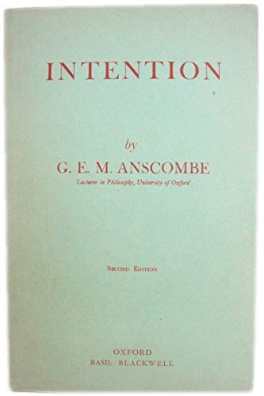

# Preliminaries

## Reminders

-  Next week is Langton, "Speech Acts and Unspeakable Acts"

# Review

## The Preliminary Distinction

-   Philosophers focus on statements---utterances that are used to state or report facts, and so are true or false, depending on whether they accurately report the facts or not.
-   But there are other uses of language.
-   Performative utterances are utterances, often with the same grammatical form as a statement, that are used to perform actions, not to make statements. They are neither true nor false.

## Felicity Conditions

Statements have **truth conditions**. Performatives have **felicity conditions**:

1. The **conventional procedure** which by our utterance we are purporting to use **must exist and be accepted**.
2. The **circumstances must be appropriate**.
3. The speaker must **have the requisite thoughts or feelings or intentions**.

When (1) or (2) fail, we have a **misfire**. When (3) fails, we have an **abuse**.

## Explicit Performatives

There are two standard "explicit" forms a performative can take:

-   First-person singular performative verb: "I promise..."
-   Performative verb in the passive voice and in the second or third person: "You are warned..."

Also:

-   You can add 'hereby': "I *hereby* promise...", "You are *hereby* warned..."

## {.center} 

Proposal
:   A performative utterance can be rewritten (without loss of force) in either of the two explicit forms.

\ 

:::displayed-sentence
Sold!

I'll be back.
:::

---

Proposal
:   A performative utterance can be rewritten (without loss of force) in either of the two explicit forms.

Problem
:   We have no criterion for when a verb is a performative verb.

The basic idea is that a performative verb is a verb that expresses a performative action---an action that you can perform in or by saying something:

-   promising, warning, agreeing, commanding, acknowledging, gaslighting, insulting, demeaning...

---

Idea
:   A performative verb is a verb that expresses a performative action.

Problem
: 'insult' is a verb that expresses a performative action, but you cannot translate performative insults ("You are an ass") into explicit peformatives ("I insult you for being an ass").

In general, no reason to suppose that a language will contain performative verbs that can be used to express explicit performatives for every performative action.

---

Second Problem
:   There are examples that are hard to categorize with confidence.

:::displayed-sentence 
I am sorry.

Out! (as said by an umpire)

Guilty! (as said by a juror)
:::

---

Third Problem
:   *Stating* is an action, just as much as *promising*, *warning*, *commanding*, etc.

## Revising the Preliminary Distinction

A statement is just one of many kinds of performative utterance:

-   All performative utterances have felicity conditions.
-   Some also have truth conditions (perhaps these are further felicity conditions).

## Examples of Infelicitous Statements

:::displayed-sentence 
The cat is on the mat but I don’t believe it is.

The present King of France is bald.

A: "I am feeling crappy today." B: "No, you are not."
:::

---

:::displayed-sentence 
I am not cheating on you. 

(Said to you by your partner who is cheating on you.)

\

He is not cheating on you. 

(Said to you by your friend who falsely believes your partner is not cheating on you.)

\ 

He is not cheating on you. 

(Said to you by your friend who falsely believes your partner is cheating on you.)
:::

---

:::displayed-sentence
A: "Have you stopped cheating on me?"

B: "No."

(B has never cheated on A.)
:::

## Revised Felicity Conditions?

1. The **conventional procedure** which by our utterance we are purporting to use **must exist and be accepted**.
2. The **circumstances must be appropriate**.
3. (Internal) The speaker must **have the requisite thoughts or feelings or intentions**.
4. (External) What the speaker says must **fit the facts**.

(4) might not apply to all performatives. But it can help explain truth conditions for statements, and maybe also the umpire and juror cases.

# Locutionary, Illocutionary, Perlocutionary

## On Performing Several Acts at Once 

## {.smaller}

> A man is pumping water into the cistern which supplies the drinking
water of a house. Someone has found a way of systematically
contaminating the source with a deadly cumulative poison whose
effects are unnoticeable until they can no longer be cured. The
house is regularly inhabited by a small group of party chiefs,
with their immediate families, who are in control of a great
state ; they are engaged in exterminating the Jews and perhaps
plan a world war.---The man who contaminated the source has
calculated that if these people are destroyed some good men will
get into power who will govern well, or even institute the
Kingdom of Heaven on earth and secure a good life for all the
people ; and he has revealed the calculation, together with the
fact about the poison, to the man who is pumping. The death of
the inhabitants of the house will, of course, have all sorts of other
effects; e.g., that a number of people unknown to these men will
receive legacies, about which they know nothing.
>
> This man's arm is going up and down, up and down. Certain
muscles, with Latin names which doctors know, are contracting
and relaxing. Certain substances are getting generated in some
nerve fibres-substances whose generation in the course of
voluntary movement interests physiologists. The moving arm
is casting a shadow on a rockery where at one place and from
one position it produces a curious effect as if a face were looking
out of the rockery. Further, the pump makes a series of clicking
noises, which are in fact beating out a noticeable rhythm.

:::notes

Two questions:

-   What is the man *doing*?
    -   sweating; casting a shadow; poisoning the inhabitants; defeating the Nazis...
-   What is the man doing *intentionally*?
-   moving his arm up and down; pumping water; earning money for his family...
:::

## Three Kinds of Speech Act

Locutionary Act
:   The act *of* saying something.

Illocutionary Act
:   The act you perform *in* saying something.

Perlocutionary Act
:   The act you perform *by* saying something (effects on audience)

:::notes
Never use prepositions to make a philosophical distinction!!!
:::

## {.center}

                          "Don't push that button!"
----------------------   -----------------------------------------------
Locutionary Act           ?
Illocutionary Act         ?
Perlocutionary Act        ?

:::notes

-  what did I say?
-  what did I do in saying that (warn)
-  what did I do by saying that (stave off nuclear war)
:::

---

                           "Shoot her!"
----------------------   -----------------------------------------------
Locutionary Act           ?
Illocutionary Act         ?
Perlocutionary Act        ?

:::notes
-  what did I say?
-  what did I do in saying that (command)
-  what did I do by saying that (persuaded you to shoot her, got you to shoot her)
:::

---

                           "You can't do that!"
----------------------   -----------------------------------------------
Locutionary Act           ?
Illocutionary Act         ?
Perlocutionary Act        ?

:::notes
illocuationary: protest

perlocutionary: checked your action; stopped your action; brought you to your senses.
:::

---

                          "That milk has gone off."
----------------------   -----------------------------------------------
Locutionary Act           ?
Illocutionary Act         ?
Perlocutionary Act        ?

## Discussion

Let's use the tools from Grice and Austin to analyze:
   
-   
-   Gaslighting
-   Sealioning

